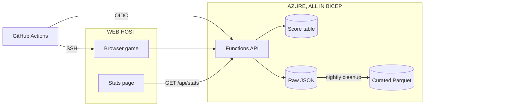

# Ylläri-Zombit

[](https://github.com/Gerlitek/zombiet-peli/actions/workflows/web.yml)
[](https://github.com/Gerlitek/zombiet-peli/actions/workflows/api.yml)
[](https://github.com/Gerlitek/zombiet-peli/actions/workflows/infra.yml)

> **In English:** *Ylläri-Zombit* means "Surprise Zombies". A small browser game (TypeScript, Phaser 4) built with AI, running on Azure. Guardrails as code
> (budget, Azure Policy, cost alert, daily caps), a keyless Python API on Azure Functions, raw JSON events refined nightly
> into a curated Parquet layer, and a static dashboard. Play it at [zombit.gerlitek.fi](https://zombit.gerlitek.fi) (desktop, in Finnish).
> Docs are in Finnish; code and commits in English.

Pieni selainpeli: taistele zombeja vastaan. Pelin idea, tarina ja hahmot ovat lapsen suunnittelemia.

Peli pyörii Azuressa, ja koko ympäristö on koodina: Bicep, CI/CD ja datakerrokset. Pelin tapahtumat tallentuvat raw-kerrokseen (JSON, poistuu 30 vrk:n jälkeen). Yöajo kirjoittaa niistä curated-kerroksen (Parquet) ja yhteenvedon, jota [tilastosivu](https://zombit.gerlitek.fi/tilastot/) näyttää.

## Arkkitehtuuri



Peli lähettää pisteet ja tapahtumat API:lle. GitHub Actions julkaisee koodin ja Azure-resurssit OIDC-kirjautumisella. Kaikki Azure-osat (API, tallennus, yöajo) ovat Bicepiä. Tilastosivu lukee yöajon tekemän yhteenvedon osoitteesta `GET /api/stats`.

Kustannussuojat: budjetti, Policy, vuorokausikatot kirjoituksille ja pyynnöille sekä lokikatto. Tallennustilaan ei pääse avaimilla, vaan API käyttää hallittua identiteettiä. Perustelut: `docs/architecture.md`.

## Dokumentit

- `docs/game-design.md`: pelisuunnitelma
- [Visuaalinen konsepti](https://zombit.gerlitek.fi/konsepti/): hahmojen ja ilmeen suunnittelu, liikkuvat kuvat (lähde `web/public/konsepti/`)
- `docs/architecture.md`: arkkitehtuuri, kustannusrajat ja päätökset
- `docs/tarina-ja-ulkoasu.md`: lapsen alkuperäiset ideat
- `CHANGELOG.md`: julkaisujen muutosloki

## Rakenne

| Kansio | Sisältö |
|---|---|
| `web/` | Peli ja tilastosivu: Vite, TypeScript, Phaser 4, Chart.js |
| `api/` | API: Azure Functions (Python), pistetaulukko, telemetria ja yöllinen curated-ajo |
| `infra/` | Azure-resurssit Bicepillä |
| `azure.yaml` | azd: Azure-puolen provisiointi ja deploy |
| `.github/workflows/` | CI/CD: infra, api ja web. Azure-kirjautuminen OIDC:llä, julkaisu hyväksynnän takana |
| `docs/` | Dokumentit |

## Kehitys

```
cd web
npm install
npm run dev     # peli osoitteessa http://localhost:5173
npm test        # yksikkötestit (Vitest)
npm run build   # tyyppitarkistus ja tuotantoversio kansioon dist/
```

Tilastosivu kehitystilassa keksityillä luvuilla: http://localhost:5173/tilastot/?demo

API (Python 3.12), samat komennot kuin CI:ssä:

```
cd api
pip install -r requirements.txt pytest ruff
ruff check .
pytest -q
```
