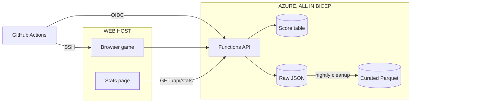

# Ylläri-Zombit

[](https://github.com/Gerlitek/zombiet-peli/actions/workflows/web.yml)
[](https://github.com/Gerlitek/zombiet-peli/actions/workflows/api.yml)
[](https://github.com/Gerlitek/zombiet-peli/actions/workflows/infra.yml)

> **Suomeksi:** Selainpeli, jonka idea, tarina ja hahmot ovat lapsen suunnittelemia. Taustalla on tuotannossa toimiva Azure-ympäristö: Bicep, CI/CD, datakerrokset ja kustannussuojat. [Pelaa](https://zombit.gerlitek.fi) tai [lue pelistä](https://zombit.gerlitek.fi/tietoa/).

*Ylläri-Zombit* ("Surprise Zombies") is a browser game (TypeScript, Phaser 4) running in production on Azure, with infrastructure as code, CI/CD, layered data and cost guardrails. The idea, story and characters were designed by a child. Play it at [zombit.gerlitek.fi](https://zombit.gerlitek.fi) (desktop). The game and its website are in Finnish, made for a Finnish audience.

The whole environment is code:

- **Infrastructure:** all Azure resources in Bicep, provisioned with GitHub Actions and the Azure Developer CLI.
- **CI/CD:** OIDC login without stored keys, every deployment behind a manual approval.
- **Data layers:** game events land in a raw layer (JSON, deleted after 30 days). A nightly job writes a curated layer (Parquet) and the summary shown on the [stats page](https://zombit.gerlitek.fi/tilastot/).
- **Cost guardrails:** budget, Azure Policy, cost anomaly alert, daily caps on writes and requests, and a log cap. Over a daily cap the API stops itself (tested in production on 2026-11-27).
- **Security:** no storage account keys, the API uses a managed identity.

## Architecture



The game sends scores and events to the API. The stats page reads the summary made by the nightly job from `GET /api/stats`. The reasoning behind each choice is in [docs/architecture.md](docs/architecture.md).

## Documents

- [docs/architecture.md](docs/architecture.md): architecture, cost limits and decisions
- [docs/game-design.md](docs/game-design.md): game design
- [CHANGELOG.md](CHANGELOG.md): release history
- [Visual concept](https://zombit.gerlitek.fi/konsepti/) (in Finnish): characters and look, with animations (source `web/public/konsepti/`)
- [About the game](https://zombit.gerlitek.fi/tietoa/) (in Finnish): how the game came to be and what it does, with screenshots (source `web/public/tietoa/`)

## Repository layout

| Folder | Contents |
|---|---|
| `web/` | Game, stats page and about page: Vite, TypeScript, Phaser 4, Chart.js |
| `api/` | API: Azure Functions (Python), score table, telemetry and the nightly curated job |
| `infra/` | Azure resources in Bicep |
| `azure.yaml` | azd: provisioning and deployment of the Azure side |
| `.github/workflows/` | CI/CD: infra, api and web |
| `docs/` | Documents |

## Development

```
cd web
npm install
npm run dev     # game at http://localhost:5173
npm test        # unit tests (Vitest)
npm run build   # type check and production build into dist/
```

Stats page with made-up numbers in development mode: http://localhost:5173/tilastot/?demo

API (Python 3.12), the same commands as in CI:

```
cd api
pip install -r requirements.txt pytest ruff
ruff check .
pytest -q
```
